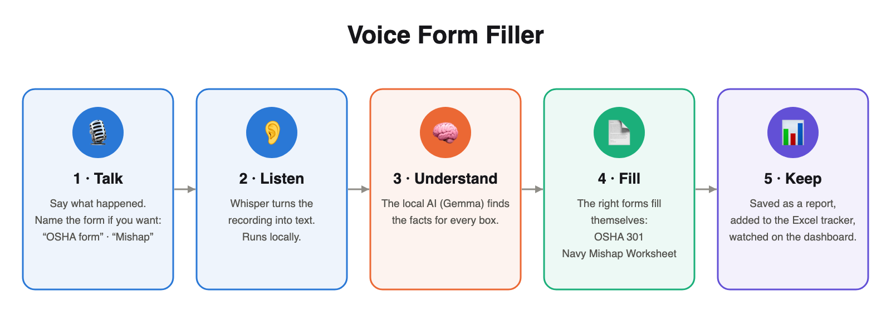

# Voice Form Filler

You tell what happened — out loud or from a voice memo — and the app does the rest:

1. **Records** your story and turns it into text.
2. **Fills the safety form** from it: **OSHA 301** — or, for a military story (a ship, unit or base), the
   **Mishap Information Worksheet** (Navy / DoD, AFSAS-style). (A South Dakota First Report of Injury map is kept
   in `templates/forms/` switched off; set its `status:` to `approved` to offer it too.)
3. **Saves** the filled PDFs.
4. **Adds the report to one Excel file** (`data_tracker/reports.xlsx`) — one row per report, one column per box.

Old filled PDFs can be brought into the same Excel file, so every report, old and new, is in one place.
Everything runs on your computer; nothing is sent to the internet.



## Step by step

Works on Mac, Windows and Linux. Needs about 16 GB of memory and 12 GB of free disk space. Fastest on an Apple
Silicon Mac (M1 or newer) or a computer with an NVIDIA graphics card; on other computers a report can take
several minutes. Steps 1–4 are done once; steps 5–6 are every report.

### Step 1 — Get the folder and open a terminal in it

Either way gives you one folder (named `voice-form-filler` or `voice-form-filler-main`):

- **Download:** on the GitHub page click the green **Code** button → **Download ZIP**, then unzip it.
- **Or with git:** `git clone https://github.com/oaitran1/voice-form-filler.git`

Put it somewhere **not** synced by OneDrive, iCloud Drive or Dropbox (e.g. `C:\Users\you\` or your home folder):
the app installs about 2 GB of files inside it, and syncing those is slow and can break the install.
Then open a terminal **in that folder**:

| Computer | How |
|---|---|
| **Mac** | Open **Terminal** (Spotlight: ⌘ Space → "Terminal"), type `cd ` (with a space), drag the folder into the window, press Enter. |
| **Windows** | Open the folder in File Explorer, click the address bar, type `powershell`, press Enter. |
| **Linux** | Right-click inside the folder → **Open in Terminal**. |

Every command below is typed in this terminal.

### Step 2 — Run the setup (one command)

| Computer | Type this, press Enter |
|---|---|
| **Mac or Linux** | `./setup.sh` |
| **Windows** | `powershell -ExecutionPolicy Bypass -File setup.ps1` |

It installs the tools, downloads the two AI models (about 10 GB — the only time it uses the internet), installs
the app, then checks itself on one test story. The first time takes a while (mostly the download). It may ask for
your computer password (to install tools). **Done when you see `✓ Set up.`** If it stops, fix what the message says
and run it again — anything already done is skipped. (On Windows the tools come from `winget` when it works, otherwise
from their own installers; if a tool still won't install, the message gives the download page.)

### Step 3 — Type your company's details (once)

Open `data/profile.yaml` in any text editor (TextEdit, Notepad, …). It starts with a **sample company** — replace
each value after the `:` with yours, keep the left side as it is, and save:

```yaml
employer_name: Your Company Name
employer_street: 100 Main Street
employer_city: Your City
employer_state: South Dakota
employer_zip: "57104"          # keep the quotes
employer_phone: 605 555 0100
employer_fein: 12-3456789      # federal tax ID
```

You can also add `employer_employee_count:`, `insurer_name:` (workers' comp insurer) and `policy_number:`.
These go on every report — unless a recording names a different company (see **What to say**).

### Step 4 — Allow the microphone (once)

The first time you record, your computer asks whether the terminal may use the microphone — click **Allow**.
(Mac: if you missed it, System Settings → Privacy & Security → Microphone → turn on Terminal. Windows: Settings →
Privacy → Microphone → allow desktop apps.)

### Step 5 — Try it with your voice (recommended before real use)

```bash
uv run live-test
```

Pick a script (1–3), press **Enter**, read the script out loud, then say **"stop recording"**. The app fills the
forms and checks every box against the script's right answers — see **Live test** below.

### Step 6 — Make a real report (every time)

```bash
uv run record
```

1. Press **Enter** (or say **"start recording"**).
2. Tell what happened in your own words, in the order under **What to say**. Pauses to think are fine.
3. Say **"stop recording"**.
4. Check **What I heard** on the screen. The app fills the forms (about a minute), saves them, adds the report to
   the Excel file and opens the filled forms. (With `uv run dashboard` open, a progress bar follows each step there
   and the filled form appears on its Reports page by itself. Changed your mind? Click the red **Stop — save
   nothing** button: the run ends at once, anything it had saved is thrown away, and you can record again.)
5. Look over each form (`*_print.pdf`). Boxes marked "pick by hand" on the screen need you. If a box is wrong,
   fix it on the printed page, or record the report again.

**Where everything is:** each report → `records/<date>_incident/` (the filled PDFs + what was heard). Every report in
one Excel file → `data_tracker/reports.xlsx`.

<details><summary>The setup steps by hand (Mac), if you'd rather not use setup.sh</summary>

```bash
brew install uv ffmpeg ollama        # Python manager, audio reader, local AI
brew services start ollama
ollama pull gemma3:12b               # the local AI (8 GB download)

cd voice_form_filler
uv sync                              # installs everything else into .venv
uv run make-report --setup           # downloads the speech-to-text model (1.5 GB)

mkdir -p data && cp templates/examples/company_profile.yaml data/profile.yaml
# open data/profile.yaml and type your company's details (employer name, address, phone, FEIN)
```

</details>

## Live test — check it with your own voice

```bash
uv run live-test              # pick a script → press Enter or say "start recording" → read it →
                              # say "stop recording" → forms filled → every box checked
uv run live-test --script 2   # just one script
uv run live-test --typed      # no microphone: checks the forms only
```

Each script (`live_test/scripts/*.yaml`) is a short made-up incident plus its right answers. After you read it,
the app fills the forms exactly as in real use. Each run makes a folder `live_test/results/<date_time>/` (it opens
by itself) with the filled PDFs and `RESULTS.md`: every box, what it should be, what the app wrote,
✓ right / ✗ wrong / 👁 written answers to read yourself. Its Excel file is `data_tracker/live_test.xlsx` (the
latest run — kept apart from your real reports). Your recordings stay on your Mac, out of git.

## With the DON Mishap Classification Assistant

If the assistant's page is in `assets/voice-rmi.html`, `uv run dashboard` opens one page with two tabs: **Voice RMI
Assistant** (the assistant, unchanged) and **Reporting Dashboard** (this app). The dashboard tab also has **Browser
voice recording**: pick the form, click **Start recording**, allow the microphone, tell what happened, click **Stop &
process**. The recording goes to the local server and through the same steps as a voice memo; the dashboard below
follows along and shows the filled form. (That works in Edge and Chrome; the dashboard's own **Record a report**
button works everywhere the server was started from a terminal.) Without the assistant file, `uv run dashboard`
shows the dashboard alone. Nothing leaves the computer either way.

## More about using it

| Other things it can do | Command |
|---|---|
| **Use a recording from your phone** (a voice memo, video, or text file) — get the file onto this computer first (AirDrop, email it to yourself, or a cable), then on the dashboard click **Use a recording from your phone**, pick the file and the form | or `uv run make-report --input ~/Downloads/incident.m4a` |
| What to say before you record | `uv run make-report --brief` |
| The dashboard: reports filed, the forms, live-test accuracy, and buttons that run each step right on the page. (pick the form, talk, watch the progress bar, see what was heard and the filled form — no other window opens; **Stop — save nothing** kills a run and throws away what it saved). Start it from a terminal (that is how it gets microphone permission); it keeps running after the window is closed. `uv run dashboard --stop` stops it; `--write` only writes `data_tracker/dashboard.html` | `uv run dashboard` |
| **Bring in old filled PDFs** (once) | `uv run add-old-pdfs ~/old_reports` |

**Start each recording with who is making the report**, e.g. *"This report is by Sam Park, Kitchen Manager,
phone 864-555-0199."* That fills OSHA's Completed by / Title / Phone boxes (left blank if you don't say it).
The company's own details (employer name, address, tax ID) come from `data/profile.yaml`, typed once.
To report for another company, say its name in the recording (e.g. *"We are Acme Plumbing, 5 Main Street,
Sioux Falls…"*): then only what you say about that company is used, and the profile is left out.

Each story is saved in `records/<date>_incident/`: the transcript, the facts, and for every form its `*_print.pdf`
plus `*_boxes.json` (every box's answer, which the Excel file is built from). Answers you didn't say are left
blank — never guessed.

**The Excel file** `data_tracker/reports.xlsx` has one sheet per form. Row 1 = the form's section titles, row 2 = its
printed labels, then one row per report. The **Source** column says *spoken report* or *old PDF*; **File** says
which PDF the row came from. PDFs it can't read (scans, other forms) are listed on the **Not exported** sheet.
It is rebuilt from the saved PDFs after every report, so it always matches them.

Old PDFs are **copied** into `records/old_pdfs/` — your originals are not touched, and a file already brought in is
skipped. Run `uv run add-old-pdfs` with nothing after it to just rebuild the Excel file.

## What to say (in this order)

Say it in your own words — this order covers every box on OSHA 301.

0. **Which form** — `uv run record` asks this first: say **"OSHA form 301"** or **"Mishap"**
   (or **"any"**, or type its number). Naming the form starts the recording — no Enter needed. On the dashboard,
   click the form's button, or click **Say it** and the recording starts the moment you name the form out loud.
   Naming a form in the story itself works too, and only that form is
   filled (and only its questions are asked). Say none of them and every form that fits the story is filled.
1. **Who you are** — "This report is by **[your name]**, **[job title]**, phone **[number]**."
   *Only if the report is for a different company than in `data/profile.yaml`:* "We are **[company name]**,
   **[street, city, state, ZIP]**, phone **[number]**." Say the name, or the profile's company is used.
2. **Who got hurt** — full name (with middle initial), male/female, job title, full/part time, hours a week,
   phone, home address (street, city, state, ZIP), date of birth, date hired.
3. **When** — the date ("October 3rd, 2026"), the time they started work, the time it happened — always with
   **a.m./p.m.**
4. **Where** — the address or place, and whether it was **on** or **not on** the employer's premises.
5. **What happened** — what they were doing (and with what), what happened, the object or substance that hurt
   them, the injury and the body part (**left/right**).
6. **Treatment** — the clinic or hospital (name, street, city, state, ZIP) and the doctor; whether they **did /
   did not** go to the emergency room; whether they **were / were not** kept overnight.
7. **Safety, witness, reporting** — safety equipment provided? used? The witness's name. Who it was reported to,
   and the date.
8. **Only if it applies** — the date they returned to work; the date of death.
9. **Military mishap only** (ship, unit, command or base) — the kind of event and the mishap type (afloat, ashore,
   aviation, motor vehicle …), the ship's name, where it was (at sea / port, nearest base, country), the exact space on the ship, the kind of event, the sequence of events with times, the weather,
   sea state, visibility, wind, and whether there were eyewitnesses. This fills the Mishap Information Worksheet.
   A preliminary report must have seven boxes — the mishap type, the one-liner, the kind of event, the local time,
   the date it was reported to the safety office, and the ISB and SIB investigators — so say them; any left blank
   is flagged after filling. The mishap type is picked from the story (a ship at sea → Afloat) even when you don't
   say the word.

Tips: say dates in full (not "yesterday" or "the same day" — the app won't guess a date); say every yes/no out
loud; anything you don't say is left blank.

## Folder map

```
src/vff/            the app's code (one small file per job)
src/vff/cli/        the commands: record, make_report, add_old_pdfs, live_test
templates/forms/    one blank PDF + one .yaml per form. The .yaml says which story fact goes in
                    which box, and (under excel:) the Excel column for every box on the page.
templates/          incident_facts.yaml (what to listen for in a story), examples/ (company profile)
live_test/scripts/  scripts to read out loud + their right answers (uv run live-test)
live_test/results/  YOUR live-test runs: filled forms + RESULTS.md. Never put in git.
docs/               private working notes (DESIGN.md, HANDOFF.md) — kept on your computer, not in git
data_tracker/       YOUR Excel files: reports.xlsx (every real report) and live_test.xlsx (latest live test)
data/, records/     YOUR private files — company profile, saved reports, old PDFs.
                    Never put in git.
```

**Add a form:** put its blank PDF in `templates/forms/` and write its `.yaml` next to it (copy one of the two
that are there), checking every box against the printed page; then set `status: approved`.
